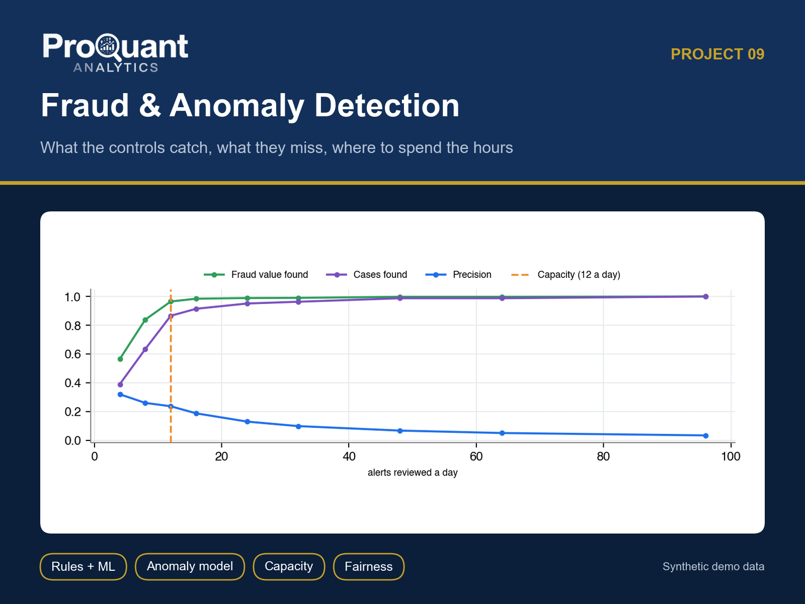
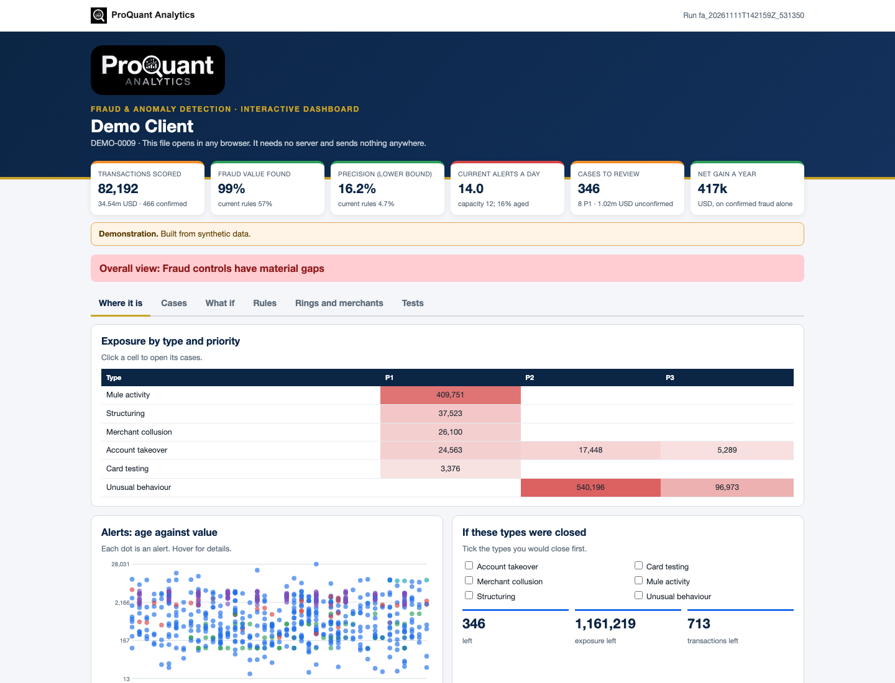
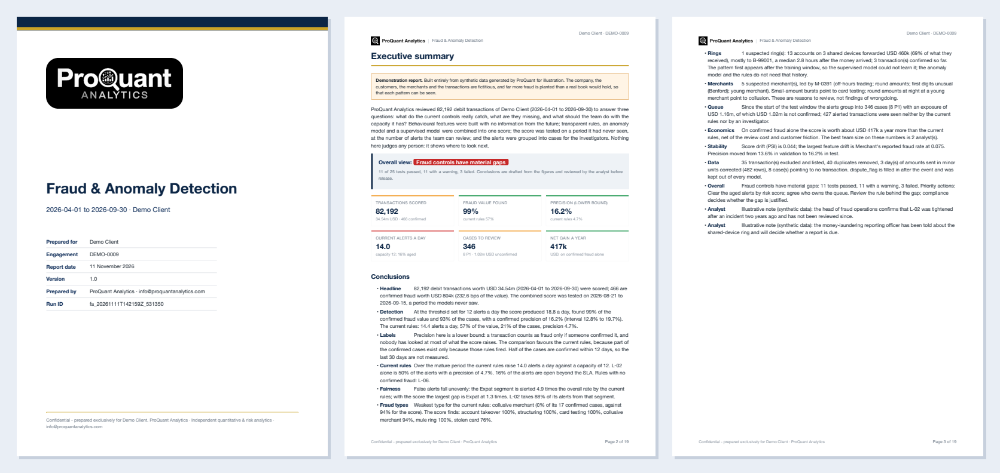
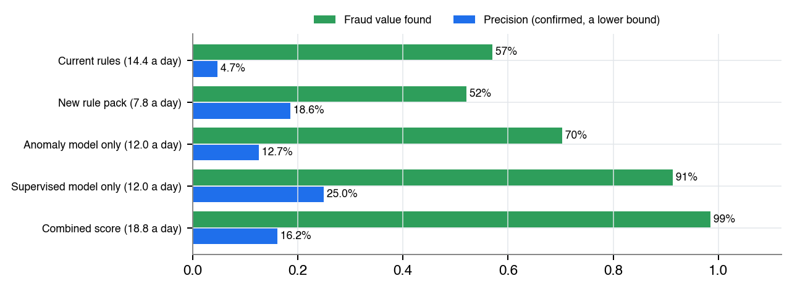
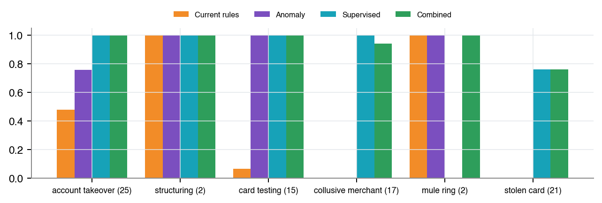
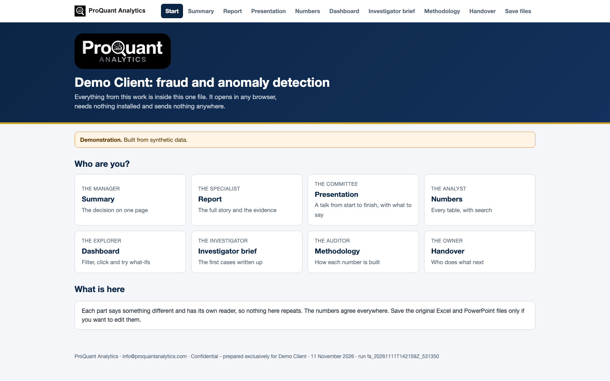

# Fraud & Anomaly Detection

**What your fraud controls catch, what they miss, and where your analysts' hours should go.**

  

> **Showcase repository.** It shows the method and the actual files a client receives, built on **synthetic demo data** (a fictional *Demo Client*). The numbers below are illustrative, not client results. The production code is proprietary and is not published here.

## Contents

- [Business problem](#business-problem)
- [Approach](#approach)
- [Results (demo)](#results-demo)
- [Deliverables](#deliverables)
- [Gallery](#gallery)
- [Tech stack](#tech-stack)
- [How to view it](#how-to-view-it)
- [How an engagement works](#how-an-engagement-works)

## Business problem

Analysts review alerts all day, most are false, some are never opened, and nobody can say how much fraud gets through. One rule floods the queue, and new patterns such as mule rings go unnoticed.

**Typical clients:** Payment companies, fintechs, banks and marketplaces with a fraud or AML review team.

## Approach

- 31 behavioural features built with no look-ahead, plus a leakage screen on every field
- Three detectors combined into one 0-999 score: transparent rules, an anomaly model and a supervised model
- Out-of-time test with precision and recall by count and value, against the current rules
- Threshold set by review capacity, with a sweep of what each extra alert buys
- Fairness of false alerts by group; ring and merchant detection; prioritised cases with reasons
- Alert rule pack in YAML and SQL, self-tested against the pipeline

## Results (demo)

**Overall opinion on the demo data:** Overall view: Fraud controls have material gaps

| Measure | Value | Context |
|---|---:|---|
| Transactions scored | **82,192** | 34.54m USD · 466 confirmed |
| Fraud value found | **99%** | current rules 57% |
| Precision (lower bound) | **16.2%** | current rules 4.7% |
| Current alerts a day | **14.0** | capacity 12; 16% aged |
| Cases to review | **346** | 8 P1 · 1.02m USD unconfirmed |
| Net gain a year | **417k** | USD, on confirmed fraud alone |

<em>The interactive dashboard (one HTML file: Where it is, Cases, What if, Rules, Rings and merchants, Tests). <a href="https://abduwars.github.io/proquant-09-fraud-detection/sample-delivery/10_DemoClient_FraudAnomaly_Dashboard_v1.0_20261111.html">Open it live</a>.</em>

## Deliverables

Everything opens from **one file**, `00_START_HERE`, in any browser: pick your role, read each document, watch the presentation, search the tables and use the dashboard. Each document has one reader and one job, and the numbers agree across all of them.

| # | File | Format | What it is |
|---|---|---|---|
| 00 | [Start here](https://abduwars.github.io/proquant-09-fraud-detection/sample-delivery/00_START_HERE_DemoClient.html) | HTML (opens in any browser) | **One file that holds it all**: every document, the presentation, the tables and the dashboard |
| 01 | [Report](sample-delivery/01_DemoClient_FraudAnomaly_Report_v1.0_20261111.pdf) | PDF | The report (~19 pages): opinion, methods compared, sweep, fraud types, current rules, new rules, fairness, rings, merchants, cases, economics, drift, data, tests |
| 02 | [Summary](sample-delivery/02_DemoClient_FraudAnomaly_Summary_v1.0_20261111.pdf) | PDF | One page: the decision, with no charts |
| 03 | [Presentation](sample-delivery/03_DemoClient_FraudAnomaly_Presentation_v1.0_20261111.pptx) | PowerPoint | **A full talk**: 14 slides with editable charts and speaker notes, ready to present |
| 04 | [Results Workbook](sample-delivery/04_DemoClient_FraudAnomaly_ResultsWorkbook_v1.0_20261111.xlsx) | Excel | **The working file**: a Control panel with live formulas, and every table. Opens on a **Read me** sheet with a linked index |
| 05 | [Methodology](sample-delivery/05_DemoClient_FraudAnomaly_Methodology_v1.0_20261111.pdf) | PDF | How each number is built (for compliance, auditors and the client's data team) |
| 06 | [Handover Note](sample-delivery/06_DemoClient_FraudAnomaly_HandoverNote_v1.0_20261111.pdf) | PDF | What was delivered, the findings, what we need for the next review |
| 07 | [Case Review](sample-delivery/07_DemoClient_FraudAnomaly_CaseReview_v1.0_20261111.xlsx) | Excel | **Case review sheet**: every case with its transactions, columns for the finding and the compliance review, and a status drop-down (Open / In review / Confirmed fraud / Not fraud / Escalated to compliance) |
| 09 | [Investigator Brief](sample-delivery/09_DemoClient_FraudAnomaly_InvestigatorBrief_v1.0_20261111.pdf) | PDF | **Investigator brief**: the first ten cases written up, with timeline, reasons, what to check and a sign-off line |
| 10 | [Dashboard](https://abduwars.github.io/proquant-09-fraud-detection/sample-delivery/10_DemoClient_FraudAnomaly_Dashboard_v1.0_20261111.html) | HTML (opens in any browser) | **Interactive dashboard in one file**: opens in any browser with no server and sends nothing anywhere; case filters and CSV export, alert slider, rules, rings, fairness, tests |

**Delivered to clients only, not in this showcase:** alert rule pack (YAML, SQL and self-test).

Also delivered: data-quality reports and long-format CSV / Parquet exports for Power BI or Looker Studio.

<em>The first pages of the PDF report.</em>

## Gallery

<table><tr>
<td width="50%"></td>
<td width="50%"></td>
</tr></table>

<em>The start page: one file, one click, nothing to install.</em>

## Tech stack

Python · pandas · NumPy · matplotlib · Jinja2 + WeasyPrint (PDF) · openpyxl (Excel) · python-pptx (PowerPoint) · pydantic · pytest · scikit-learn

Every run is reproducible and audited: data fingerprints, configuration and code version are recorded, data-quality checks run before any calculation, and an automated test suite checks every deliverable (including opening the decks and workbooks in Microsoft Office).

## How to view it

1. **In the browser (nothing to install):** open the [live start page](https://abduwars.github.io/proquant-09-fraud-detection/sample-delivery/00_START_HERE_DemoClient.html) or the [dashboard](https://abduwars.github.io/proquant-09-fraud-detection/sample-delivery/10_DemoClient_FraudAnomaly_Dashboard_v1.0_20261111.html).
2. **Download:** click any PDF, Excel or PowerPoint file in the table above, or clone the repository: `git clone https://github.com/AbduWars/proquant-09-fraud-detection.git`.
3. **On your own data:** this is delivered as a fixed-scope engagement. Write to [info@proquantanalytics.com](mailto:info@proquantanalytics.com).

## How an engagement works

| Step | What happens |
|---|---|
| 1. Discovery call | Your question, your data and the decision the work must support |
| 2. Scope and NDA | Fixed scope, timeline and thresholds agreed **before** any result is seen |
| 3. Data request | A precise list of files or read-only access; personal data pseudonymised |
| 4. Build and interim update | First results, open questions and data issues, early |
| 5. Delivery | The full package above, on your data, with a walk-through |
| 6. Handover | Methodology, runbook where relevant, and optional monthly refresh |

---

<b>ProQuant Analytics</b> · Quant & risk analytics, business analytics and data engineering Rotterdam, NL · remote-first <a href="https://www.proquant-analytics.com">www.proquant-analytics.com</a> · <a href="mailto:info@proquantanalytics.com">info@proquantanalytics.com</a> · <a href="https://github.com/AbduWars">All 12 projects</a>

© 2026 ProQuant Analytics. Sample outputs on synthetic data, shown for demonstration. All rights reserved.

